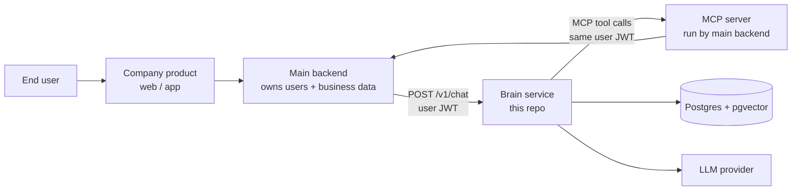

# Brain Template: Repo Plan

Status: approved 2026-11-25. M0 and M1 built; see section 8.

## 1. Goal

An industry-agnostic template for a company's AI microservice (its "brain"). A company clones
it, adds one folder describing itself (docs, tools, roles, prompts, eval cases), and gets a
working assistant that implements all the AI layers from the notes (Modules 01-09).

Two proofs ship with it:

- `examples/edtech`: a full brain for a fictional ed-tech company.
- `examples/rides`: a deliberately small brain for a fictional ride-hailing company. Its job is
  to prove the core is agnostic: it must be added without changing `core/`.

### Non-goals

- Not a competitor to Onyx, Dify or RAGFlow. No connector marketplace, no admin console.
- No multi-tenancy. One deployment serves one company. Access control is roles inside it.
- No fine-tuning or self-hosted GPU serving. Hosted API plus an optional local model.
- No rich frontend. One minimal chat page for demos.

## 2. How it fits next to a company's product



- The main backend authenticates the user and calls the brain with the user's JWT.
- The brain never talks to the company database. Business data and actions come only through
  the company's MCP server, called with the same user JWT, so the backend enforces its own
  permissions (Module 06: tools run as the user, not as a god account).
- The brain owns only its own data: document chunks, vectors, caches, traces, audit log.

## 3. Architecture decisions

| # | Decision | Why | Trade-off accepted |
|---|---|---|---|
| 1 | Modular monolith, ports and adapters | One developer, unclear boundaries early; every layer is an interface with swappable adapters | Not independently scalable per layer |
| 2 | Python 3.12+, FastAPI, Pydantic v2, uv | Matches the notes and the author's stack; SSE streaming is simple | None significant |
| 3 | Storage behind interfaces: SQLite + numpy adapter for zero-install local dev, Postgres + pgvector adapter for production | The repo must run with no Docker and no paid service; production still gets SQL `WHERE` ACL filtering | Two adapters to keep in step; the local one is not for scale |
| 4 | No agent framework (no LangChain / LangGraph) | The point is readable layers; the agent loop is ~100 lines | We maintain the loop ourselves |
| 5 | Tools only via MCP | Industry-agnostic by construction: core never names a tool | Company must run an MCP server |
| 6 | Model-agnostic provider layer: `Provider` and `ModelTier` enums, one adapter per provider (Claude Code CLI, Anthropic, OpenAI, Ollama, Fake), chosen by config | Switching vendor is a config change; code asks for a tier, never a model name | Each adapter must map tool calling and usage into our own types |
| 6a | Development and the author's testing use the Claude Code CLI adapter (`claude -p` on a subscription) | No API key and no cost for the author | CLI adapter has no native tool-calling loop control; tool and agent milestones may need Ollama or another adapter |
| 7 | Local embeddings by default (sentence-transformers) | Free, no second vendor; interface allows a hosted embedder | Lower retrieval quality than top hosted embedders |
| 8 | Cache behind an interface, stored in the same local or Postgres store; Redis adapter later | Fewer moving parts | Slower than Redis; fine at demo scale |
| 9 | Own trace table + JSON logs; optional OpenTelemetry export | Works with zero extra services; companies plug in their own backend | No trace UI out of the box |
| 10 | A company is a "domain pack" folder + one `brain.yaml` | Makes "what do I change?" a single folder | Config schema must stay small and stable |
| 11 | Code standards: SOLID, dependency injection through an app factory, Protocols as ports, Strategy / Adapter / Factory / Chain of Responsibility where they fit; ruff + mypy strict + import-linter in CI | Readable reference code is the product | More files than a script-style project |

## 4. Repo layout

```
brain-template/
  core/                      # generic. Never imports from examples/.
    api/                     # FastAPI app, /v1/chat (SSE), /v1/ingest, /healthz
    config/                  # brain.yaml schema + domain pack loader
    llm/                     # 01  LLMProvider, adapters, FallbackChain
    prompts/                 # 02  prompt skeletons, renderer, versioning
    rag/                     # 03  Loader, Chunker, Embedder, VectorStore, Retriever
    tools/                   # 04  MCP client, tool registry, result limits
    agent/                   # 05  agent loop, budgets, approval gate
    access/                  # 06  JWT verify, User, policy engine, audit log
    guardrails/              # 07  input + output guard pipeline
    cache/                   # 08  exact cache, semantic cache
    router/                  # 08  tier router, cascade
    observability/           # 09  tracer, cost accounting
    evals/                   # 09  eval runner + graders (cases live in the pack)
    pipeline.py              # composes the layers for one request
  examples/
    edtech/                  # full domain pack (see section 6)
    rides/                   # small domain pack, agnosticism proof
  web/                       # one static chat page for demos
  infra/                     # docker-compose: postgres+pgvector, brain, demo MCP server
  tests/
    unit/                    # each layer with fakes
    boundary/                # asserts core/ has no imports from examples/ and no domain words
    e2e/                     # one chat request per example, with a fake LLM
  docs/                      # PLAN.md, architecture, "make your own brain" guide
  Makefile  pyproject.toml  README.md  LICENSE
```

## 5. Interfaces per layer

Each is a `typing.Protocol` in `core/`. Adapters implement them; the pipeline depends only on
the protocols. Signatures are indicative.

| Layer | Protocol | Key method | First adapters |
|---|---|---|---|
| 01 Model | `LLMProvider` | `complete(system, messages, tools, tier) -> Completion` | Anthropic, Ollama, FallbackChain |
| 02 Prompt | `PromptStore` | `render(name, version, vars) -> str` | File-based (pack's `prompts/`) |
| 03 RAG | `Loader` | `load() -> Iterable[Document]` | Markdown folder, PDF folder |
| 03 RAG | `Chunker` | `split(doc) -> list[Chunk]` | Structure-aware recursive |
| 03 RAG | `Embedder` | `embed(texts) -> list[vector]` | sentence-transformers |
| 03 RAG | `Retriever` | `search(user, query, k) -> list[Chunk]` | pgvector + keyword, RRF fusion |
| 04 Tools | `ToolSource` | `list_tools()`, `call(user, name, args) -> ToolResult` | MCP client |
| 05 Agent | `Agent` | `run(user, question, tier) -> Answer` | Loop with step + token budget |
| 06 Access | `Authenticator` | `verify(token) -> User` | JWT (shared secret or JWKS) |
| 06 Access | `Policy` | `allowed_labels(user) -> set[str]`, `can_call(user, tool) -> bool` | YAML rules from the pack |
| 07 Guardrails | `InputGuard` / `OutputGuard` | `check(...)`, raises `Blocked` or redacts | PII redactor, injection check, grounding check |
| 08 Cache | `Cache` | `get(user, q)`, `put(user, q, answer)` | Exact (Postgres), semantic |
| 08 Router | `Router` | `pick_tier(question) -> "small" / "mid" / "large"` | Rules, small-model classifier |
| 09 Observability | `Tracer` | `span(name, **attrs)` context manager | Postgres + JSON logs |
| 09 Evals | `Grader` | `grade(case, answer) -> Score` | Code grader, LLM judge |

Core data types: `User(id, roles, attrs)`, `Document(text, source, labels)`,
`Chunk(text, source, labels, vector)`, `Answer(text, sources, cached, tier)`.

`labels` is the generic access hook: a set of strings on every document. The pack's policy
maps a user's roles to the labels they may read. Core never knows what a label means.

## 6. The domain pack contract

Everything a company changes lives in one folder:

```
examples/edtech/
  brain.yaml          # name, persona file, model per tier, router rules, guardrail
                      # settings, budgets, which loaders to run
  prompts/            # system.md and any task prompts (versioned by filename)
  docs/               # the corpus. Front matter on each file sets `labels`
  policy.yaml         # role -> readable labels, role -> callable tools, tools needing approval
  mcp_server/         # demo stand-in for the company backend: fake data + MCP tools
  seed/               # fake users (JWTs for the demo), sample business data
  evals/cases.jsonl   # question, user role, expected facts / expected refusal
  loaders.py          # optional custom Loader implementations
```

### Pack 1: ed-tech (full)

Skilvanta: a fictional company that sells courses, mentors learners and helps with placement.
All data is synthetic and the README says so.

- Roles: `learner`, `mentor`, `support_agent`, `admin`.
- Docs (~40 files): course catalog, curricula, refund and placement policies, FAQs, an
  internal mentor handbook (label `internal`), placement stats (label `admin_only`).
- MCP tools: `get_my_enrollments`, `get_progress(learner_id)`, `list_mentor_slots`,
  `book_mentor_session` (write), `request_refund` (write, needs human approval).
- Access examples: a learner cannot read another learner's progress; only mentors and admins
  read `internal`; only admins read `admin_only`.
- Evals (~60 cases): policy questions with citations, tool tasks, access-denied cases,
  injection attempts, off-topic questions, "I don't know" cases.

### Pack 2: ride-hailing (small)

Driver support for Zipvaha, a fictional ride-hailing company.

- Roles: `driver`, `ops`.
- Docs (~8 files): payout policy, incentive rules, deactivation appeals.
- MCP tools: `get_my_payouts`, `raise_dispute` (write).
- Evals (~15 cases).
- Acceptance rule: built with zero changes under `core/`. Any change needed is logged as a
  bias found, fixed in core, and noted in `docs/agnosticism.md`.

## 7. Boundary rules (how agnosticism is enforced)

1. `core/` never imports from `examples/`. Enforced by an import-linter contract in CI.
2. `core/` contains no domain vocabulary. A test greps `core/` for a deny-list
   (course, learner, mentor, driver, ride, refund...).
3. Core prompts are skeletons with slots; all persona and policy text comes from the pack.
4. Core never references a tool name or a role name. Both come from MCP discovery and
   `policy.yaml`.
5. The service starts with `BRAIN_PACK=examples/edtech` (or any path). Switching packs is an
   environment variable, not a code change.

## 8. Milestones

Order follows Module 10's roadmap (observability early, so every later layer is measurable).
Each milestone ends with a runnable state and tests.

| # | Milestone | Done when |
|---|---|---|
| M0 | Skeleton (done) | Repo, pyproject, `/healthz`, CI running lint + types + boundary tests, pack loader reads `brain.yaml`, provider and tier enums |
| M1 | Model (01) (done) | `/v1/chat` streams an answer through `LLMProvider`; Claude Code CLI, Anthropic, OpenAI and Ollama adapters built by a factory from the `Provider` enum; fallback chain with circuit breaker; fake LLM for tests |
| M2 | Prompt (02) | System prompt rendered from the pack's files with a version; structured output for one task; prompt version recorded per request |
| M3 | RAG (03) | `make ingest` loads, chunks, embeds the ed-tech docs; answers cite sources; says "I don't know" when retrieval is empty |
| M4 | Observability + evals (09) | Every request writes a trace (tokens, cost, latency, prompt version, chunk ids); `make eval` runs the pack's cases and prints a pass rate; CI fails below a threshold |
| M5 | Tools (04) | Demo MCP server for ed-tech; brain discovers tools and completes a single tool round trip; tool errors handled |
| M6 | Agent (05) | Multi-step tasks work within step and token budgets; write tools pause for approval; per-step traces |
| M7 | Access (06) | JWT verified; retrieval filtered by labels in SQL; tool calls checked against policy and forwarded with the user token; audit log; access-denied eval cases pass |
| M8 | Guardrails (07) | Input and output guard pipeline; PII redaction before logging; injection and grounding checks; injection eval cases pass |
| M9 | Cache + router (08) | Prompt caching verified from usage; exact and semantic cache scoped by access labels; router sends easy questions to the small tier; eval pass rate holds while cost per question drops |
| M10 | Second pack | `examples/rides` works end to end with no change under `core/`; findings written up |
| M11 | Template polish | "Make your own brain" guide, README with architecture diagram, demo page, measured numbers (eval pass rate, cost per question, cache hit rate), repo marked as a GitHub template |

Thin first: each layer gets its simplest working version in its milestone. Depth (reranking,
cascade routing, LLM-judge calibration) comes after M10, guided by eval results.

## 9. Decisions made (2026-11-25)

| Decision | Outcome |
|---|---|
| LLM access | No paid API. The author develops and tests through the Claude Code CLI adapter; Ollama is the free fallback. Anthropic and OpenAI adapters ship for people who have keys but are not exercised against live APIs by the author. |
| Company names | Skilvanta (ed-tech), Zipvaha (ride-hailing). A web search found no company using either name. |
| Licence | MIT |
| Repo shape | One repo while building; the ed-tech brain moves to its own repo at M11 |
| Model agnosticism | Required. Enums for provider and tier; vendor switch is a `brain.yaml` change |

## 10. Risks

- Scope: 11 milestones across 9 layers. Mitigation: thin-first rule, and M4 before the complex layers.
- Over-abstraction: adding config for things only one pack needs. Mitigation: a setting enters
  `brain.yaml` only when the second pack needs a different value.
- Demo quality on local models: weaker tool use and reasoning. Mitigation: record the demo and
  the published numbers with the hosted model, and say which model produced them.
- Cost while developing: evals call the model repeatedly. Mitigation: fake LLM in unit and e2e
  tests, small tier for routine eval runs.
